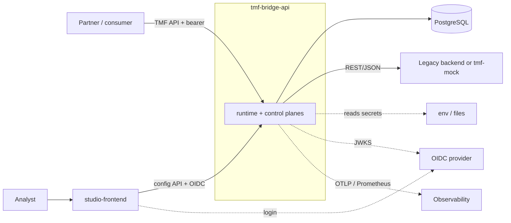
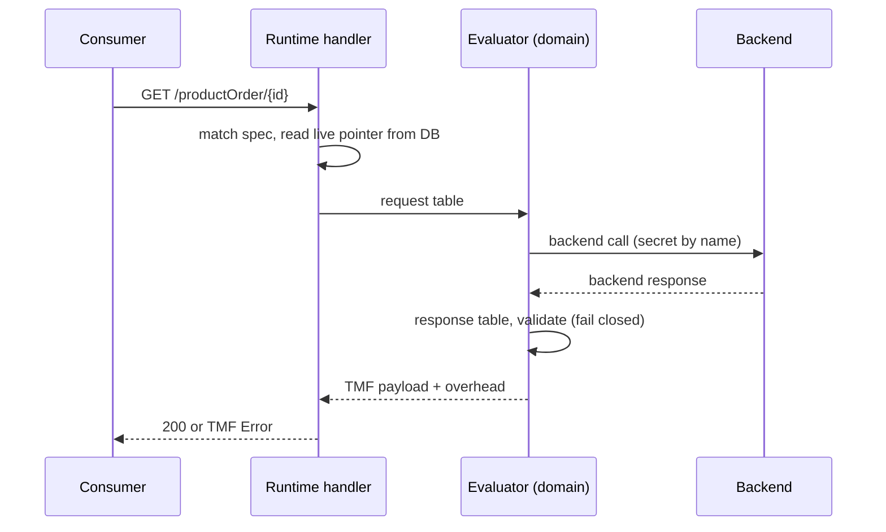
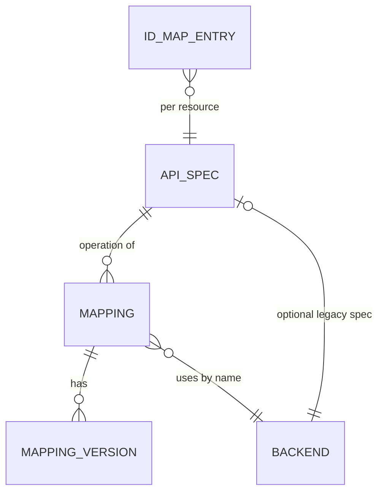

# Architecture Spine — TMF-Bridge

## Design Paradigm

**Interpreter runtime, hexagonal.** One generic engine evaluates configuration that lives in the database. TMF APIs (OpenAPI), mappings and backends are data. No per-API code.

```text
tmf-bridge-api (one Maven module, package-by-layer, roots under com.tmfbridge)
  domain/        pure core: model, evaluator, transforms, canonicalizer, redaction, ports (interfaces). No Spring, no HTTP, no JPA.
  application/   use cases per plane: runtime/ (serve call), control/ (studio, config, import/export, test, preview)
  adapter/in/    web/runtime (TMF catch-all), web/control (config API), security
  adapter/out/   persistence (JPA), backend (RestClient), secrets (env/file), observability
  bootstrap/     config, profiles, seeders
```

Two planes inside one app: **data plane** (serve TMF calls) and **control plane** (studio API, drafts, import/export, id-map admin, test, preview). Control plane beans are profile-gated.

## Invariants & Rules

```mermaid
graph TD
  AIR[adapter/in/web/runtime] --> APR[application/runtime]
  AIC[adapter/in/web/control] --> APC[application/control]
  APR --> D[domain]
  APC --> D
  AO[adapter/out/*] --> D
  APR -. ports .-> AO
  APC -. ports .-> AO
  APC -.x.- APR
  AIC -.x.- AIR
```

Solid arrows are allowed dependencies. `x` links are forbidden. `application/runtime` and `application/control` never import each other. Adapters implement domain ports. Domain depends on nothing.

### AD-1 — Config is data, the engine is generic [ADOPTED]

- **Binds:** FR-1, FR-3, FR-5, FR-10
- **Prevents:** per-API controllers, DTOs generated from OpenAPI, a rebuild to add an API or a mapping
- **Rule:** TMF routing, validation and translation are driven only by stored ApiSpecs and MappingVersions. No class, route or bean is named after a TMF resource. Check: ArchUnit forbids package or class names matching TMF resource names under `main`. A test adds a spec and mapping at runtime and serves them with no restart.

### AD-2 — Hexagonal layering, machine-enforced [ADOPTED]

- **Binds:** all
- **Prevents:** framework types in the domain, adapters calling adapters, logic in controllers
- **Rule:** dependency direction is the diagram above. Domain imports nothing from Spring, Jakarta, Jackson-annotated web types, JPA or adapters. Adapters talk only through domain ports. Check: one ArchUnit suite in CI, failing the build.

### AD-3 — Control plane and data plane split in one deployable [ADOPTED]

- **Binds:** FR-3, FR-12, FR-13, FR-14, NFR-1
- **Prevents:** runtime reading drafts, data plane importing control code, a runtime-only pod mutating schema or config
- **Rule:**
  - Control-plane beans are active only under Spring profile `control`. Data plane runs with or without it.
  - `application/runtime` and `adapter/in/web/runtime` never depend on `*/control*` (ArchUnit). CI also boots the app with `control` off and asserts the TMF call path works.
  - Data plane reads published versions only, and is read-only on config tables in S1.
  - Only `control` instances (or a Helm pre-upgrade Job) run Flyway. Data-plane instances never migrate. A data-plane pod whose schema is older than required reports not-ready (readiness probe) and keeps retrying, it does not crash-loop. Upgrade order: migrate first, then roll data-plane pods.

### AD-4 — Three images, studio is a pure client [ADOPTED]

- **Binds:** FR-10, FR-14, FR-27, NFR-2..NFR-6
- **Prevents:** private studio endpoints, studio logic that the REST API lacks, CORS sprawl
- **Rule:** images are `tmf-bridge-api`, `studio-frontend` (static SPA) and `tmf-mock` (WireMock). The studio calls only the public config API. A test asserts every studio request path and method exists in the springdoc-generated control-plane OpenAPI. The ingress routes studio, config API and TMF paths on one origin. Runtime-only deployment is the API with `control` off and no studio image.

### AD-5 — One evaluator, lineage as observer, test mode is guarded [ADOPTED]

- **Binds:** FR-11, FR-13, FR-20, FR-21, FR-28, FR-30
- **Prevents:** studio tests showing behavior production does not have, test calls with side effects, lineage code paths that diverge
- **Rule:**
  - Studio tests and production calls run the same domain `CallPipeline` (spec matching, request validation, request table, backend call, response table, response validation, error table, overhead timer, evaluator). `application/runtime` and `application/control` both call it and re-implement none of it. Lineage and step results are an optional observer, on only for studio tests. Production calls return neither (FR-20 and FR-21 are studio-test features in S1 [ASSUMPTION]).
  - The backend-client port is wrapped in test mode by a guard that allows GET only and fails before any network I/O. Test: a non-GET mapping in test mode fails without sending.
  - `POST /preview` is a stateless use case: persists nothing, has no write port and no draft or mapping repository (ArchUnit on that use case), sample bodies never reach any log, DB row or mapping document. The mapping JSON Schema has no sample field. Test: after preview and test calls, grep logs and the DB for the sample values. It may use the read-only `IdMapReadPort` that `idMap` nodes need.
  - Drafts are loaded by the control plane and handed to the pipeline. The data plane never loads a draft.

### AD-6 — Mapping document: canonical JSON, closed expression tree, JSON Pointer [ADOPTED]

- **Binds:** FR-5, FR-7, FR-10, FR-18, FR-21, FR-28
- **Prevents:** free-form script strings, two address syntaxes, ambiguous multi-match results, a second serialization
- **Rule:**
  - A MappingVersion is one JSON document with a request rule table and a response rule table, validated against a published JSON Schema. Flow: request table, backend call, response table. Step results (FR-20) are the two table outputs and the call.
  - A rule is `{target, expr}`. `expr` is a closed tree. Node vocabulary S1: `path`, `lit`, `concat`, `coalesce`, `if`, `lookup`, `convert`, `idMap`, `map`, `filter`. Each node type has a schema entry and a contract test. Adding a node is code plus a schema entry, never an unchecked string.
  - Every address, read and write, is a JSON Pointer (RFC 6901). `path` carries `syntax`: `"pointer"` in S1, `"jsonpath"` reserved. Iteration and filtering are `map` and `filter` nodes, never path syntax. The studio mapping table renders an array rule as a nested sub-table. This extends the PRD's closed FR-5 list (see PRD Amendments). A path in a scalar slot that resolves to nothing is a mapping error, not a null.
  - `{"op":"expr","text":"..."}` is reserved for a later textual language (CEL candidate). S1 rejects it at validation.
  - The mapping JSON Schema is a published, versioned contract (it also serves the Later AI-assisted generation). Every mapping document carries `schemaVersion` (S1: 1). An unknown value is rejected. A future schema bump ships a Flyway migration that migrates stored documents.
  - Evaluation context. Request table pointer root: `{"path":{…},"query":{…},"headers":{…},"body":…}` from the TMF call. Request table output: the backend request `{"method","path","query","headers","body"}`. Response table pointer root: `{"request":<request root>,"status":<int>,"headers":{…},"body":…}`. Inside `map` and `filter`, `path` is relative to the current item and the reserved pointer `/$root/...` addresses the table root. Absent and JSON `null` are different: a `path` to an absent location is a mapping error, to `null` yields `null`.
  - A mapping error at runtime is a bridge fault, answered with `502` and a generic TMF Error (AD-11), details to logs only (FR-4). A missing id-map entry, forward or reverse, is a mapping error.
  - The in-memory value type in the domain is Jackson `JsonNode`, the only third-party type allowed in `domain` (ArchUnit allowlist). Number handling is `BigDecimal`, never `double`.

### AD-7 — Persistence: Postgres, immutable versions, JPA with strict rules [ADOPTED]

- **Binds:** FR-5, FR-6, FR-12, FR-31, FR-32, FR-33, FR-34, FR-39
- **Prevents:** mutated live versions, stale compiled mappings, JPA lazy-loading and session leaks, timezone drift
- **Rule:**
  - Single store: PostgreSQL. Config writer is the control plane only. Entities and owners: see Structural Seed ERD.
  - Applied MappingVersions and ApiSpecs are immutable. Apply moves the Mapping's live pointer and deletes nothing. A Flyway-managed DB trigger rejects UPDATE and DELETE on applied rows, plus a test.
  - Identity. One Mapping per operation. Its natural key is `(apiSpec content hash, HTTP method, path template)`. The mapping `name` is a label (FR-35), unique per deployment. `MappingVersion.number` is the business version ("Version 2 is live"). It is distinct from `lockRevision`, the JPA lock column.
  - At most one Draft per Mapping (unique partial index). Autosave updates that Draft. Editing a Live mapping creates the Draft of number+1.
  - The ETag on the config API is the Mapping's `lockRevision`, which covers the live pointer and its Draft. Autosave and Apply both send `If-Match` (stricter than FR-32, which blocks only Apply, by user choice). A stale value answers `412`, the studio keeps the user's unsaved edits and shows the FR-32 message ("Reload the latest version before you apply").
  - The compiled mapping cache is keyed by immutable `(mappingId, number)`, the compiled spec cache by content hash. The live pointer is read from the DB on every call. No invalidation protocol.
  - Backends and id-map entries are read from the DB on every call, never cached, so edits take effect on the next call (FR-34, FR-39). `IdMapReadPort` offers forward lookup `(resource, tmfId)` to backend id and reverse lookup `(resource, backendId)` to TMF id, each indexed. A miss in either direction is a mapping error (`502`, FR-6), never a `404`, so it cannot be mistaken for a backend not found. Reverse uniqueness (unique index on `resource + backendId`) applies to screen add, edit and import alike.
  - Deleting a Backend that any MappingVersion (Draft or applied) references is refused with `409` listing those mappings. `GET` on a Backend returns `usedBy[]`. Test.
  - Spring Data JPA, all associations LAZY, explicit JPQL fetch, no entity graphs, entities confined to `adapter/out/persistence` and never returned across a port (mappers convert). `open-in-view=false`. `ddl-auto=none`, Flyway owns the schema (versioned SQL migrations). Explicit timezone config, UTC normalization in the DB. Mapping documents are an opaque column.

### AD-8 — One canonicalizer, atomic import, bundle format [ADOPTED]

- **Binds:** FR-14..FR-18, FR-30, FR-38
- **Prevents:** non-deterministic exports, partially applied imports, secret leaks in exports
- **Rule:**
  - Exports, share bundles and hashes serialize only through the domain canonicalizer (stable key order, fixed indent, collections sorted by natural key: mappings by operation key, backends by name, id-map entries by `(resource, tmfId)`, specs by hash). Never a raw DB column. Test: export, import, export is byte-identical.
  - The whole export carries Draft and Live mappings, each with status and number, plus backends and id-map entries. A per-mapping export carries the Live version when one exists, otherwise the Draft, never id-map entries, and names its backend without carrying a backend definition.
  - Exports carry no generated ids. A mapping references its spec by content hash plus `(method, path)`, and its backend by name. Import matches mappings by that natural key.
  - Exports never contain secret values by construction (the schema has no value field). The Redactor (AD-10) is not used for exports, so export determinism never depends on JVM state.
  - Import validates the whole file first (schema, references, id-map clashes, backend clashes) and reports every error with a JSON Pointer location, then commits in one DB transaction. Mappings always land as Draft. Live config is never changed. Backends and id-map entries are added only when new. An identical backend (same name and definition) or id-map entry is skipped, so re-importing an export into the same runtime succeeds. A backend with the same name and a different definition, or an id-map clash, rejects the file. A mapping naming a backend found neither in the file nor in the runtime also rejects the file (FR-17). An id-map entry whose backend id is already mapped from another TMF id of the same resource is also a clash, so reverse lookup has one answer (extends FR-39). A mapping whose Mapping already has a Draft is not invalid: the import request must carry `onDraftConflict=replace|skip`. Without it the import answers `409` listing the conflicts, and the studio asks the user per import. `replace` overwrites that Draft, `skip` leaves it and the file's mapping is not imported. A mapping with no Draft imports as the Draft of its next number, also when its Mapping is Live. This refines FR-17 and is logged as a PRD amendment.
  - Share bundle is one `.zip`: `manifest.json` (timestamp, formatVersion), `mapping.json`, `sample-request.json`, `sample-response.json`, `exchange.json`, `verdict.json`, `postman.json`. All but the manifest are canonical JSON. Samples are masked by FR-19 paths with the single token `"***"`. Secret values are `$SECRET_VALUE`. The server assembles the bundle, curl and Postman output from the exchange record the studio posts, and stores nothing.

### AD-9 — OpenAPI specs are data [ADOPTED]

- **Binds:** FR-1, FR-2, FR-8, FR-15
- **Prevents:** a rebuild to add an API, specs only on the classpath, version collisions
- **Rule:** ApiSpecs are stored in the DB, content-hashed, and uploaded through the config API. The image seeds TMF620 and TMF622 v4 on first boot, and the DB wins afterwards. Whole-config export carries full spec text. The routing table is derived from each stored spec's `servers` and `paths`. v4 and v5 can coexist if both are loaded, and S1 ships v4 only. An operation absent from every stored spec, or present in a spec but with no Live mapping, returns `501` with a TMF Error. A configured operation with an unknown id returns `404`.

### AD-10 — Secrets by name, one redaction chokepoint [ADOPTED]

- **Binds:** FR-16, FR-19, FR-23, FR-26, FR-34
- **Prevents:** secret values in DB, logs, exports or lineage; ad-hoc redaction
- **Rule:**
  - Backends store a secret name matching `[A-Za-z0-9_-]{1,64}`. The `SecretResolver` port resolves at call time from env `TMFBRIDGE_SECRET_<NAME>` or file `<secrets-dir>/<name>`. File wins over env. A secret is one opaque string. `authType` (bearer, basic, api-key) is non-secret backend config, and basic is `user:pass`. File rotation without restart is Later.
  - Every resolved value is registered with a single `Redactor`. Logs, step results, lineage and bundles pass through it (exports do not, see AD-8). Sensitive paths (FR-19) are configurable JSON Pointers (dotted input is normalized), one list, one `***` token for logs, step results, lineage and bundles. Test: inject a known secret, run every flow, grep all outputs.
  - The "list provisioned names" API returns names only. Backend endpoints are validated on save and import: no userinfo and no credential-like query parameters, otherwise rejected (FR-16 "other credentials").

### AD-11 — Runtime pipeline: blocking MVC on virtual threads, fail closed [ADOPTED]

- **Binds:** FR-1..FR-4, FR-8, NFR-1
- **Prevents:** reactive code in a blocking codebase, unvalidated payloads leaving the bridge, leaked backend internals, inconsistent error codes
- **Rule:**
  - Spring MVC on Java 25 virtual threads, `RestClient` for backends. No reactive types.
  - One generic catch-all handler dispatches via AD-9 into the domain `CallPipeline` (AD-5). The validator sits behind a domain port, and its library is bound in the Stack table.
  - Invalid request: `400`. Invalid translated response: `502` TMF Error, the bad payload never returned, details to logs only.
  - Fixed error table (FR-4): invalid request gives `400`, backend 404 gives `404`, other 4xx gives `502`, 5xx gives `502`, timeout gives `504`, transport failure gives `502`, invalid translated response gives `502`, mapping error including an id-map miss gives `502`. Bodies are generic. Original error goes to logs through the Redactor.
  - Timeout: global default 5 s, optional per-backend value. No retries in S1.

### AD-12 — Bridge overhead definition [ADOPTED]

- **Binds:** FR-22, NFR-1
- **Prevents:** unmeasurable or disputed performance claims
- **Rule:** overhead = total call time minus the time of the outbound backend call as the bridge sees it, measured by one Micrometer timer `bridge.overhead`. Target p95 < 100 ms with warm compiled-mapping and spec caches, one instance, zero-latency mock, payload ≤ 50 KB. Lineage and step-result capture excluded (FR-20, FR-21). The value is returned for studio test calls, feeds the verdict note, and every runtime response carries it in a `Server-Timing: bridge;dur=<ms>` header (FR-22 "every call").

### AD-13 — Security: one filter chain per plane [ADOPTED]

- **Binds:** FR-24, FR-25, FR-36, NFR-2
- **Prevents:** an open admin API, runtime auth coupled to control-plane auth
- **Rule:** Spring Security with separate `SecurityFilterChain`s selected by `securityMatcher` on path prefix. The control and config chain is always authenticated (OIDC JWT, API as resource server with `issuer-uri`) and has no toggle. The runtime chain requires a bearer token by default, and `tmfbridge.runtime.auth.enabled` can disable it independently. The studio is a public SPA client (authorization code with PKCE). Both chains validate tokens from one issuer. Accepted audiences are separate properties per chain. No roles in S1. Test: enumerate the springdoc-collected control-plane endpoints and assert `401` without a token.

### AD-14 — Verdict rules apply per sub-step [ADOPTED]

- **Binds:** FR-28, FR-29
- **Prevents:** a "pass" for a check that never ran
- **Rule:** id-map-transform-present, id-map-entry-found and empty-mapped-fields apply to sub-steps a, b and c (preview reads the id map through `IdMapReadPort`, never writes it). OpenAPI validation is request-side in a, response-side in b, both in c. HTTP status, backend reachable, secret provisioned and overhead apply to c only. Non-applicable rules are skipped, never reported as passed. The rule set is closed in S1. The control plane computes the verdict server-side, the studio only renders it. A failed backend-reachable or secret-provisioned check gives a failed verdict. Overhead above target is an info note beside a pass and never blocks. Every verdict has four parts: what happened, likely meaning, what to try, who to ask.

### AD-15 — No resource state beyond configuration in S1 [ADOPTED]

- **Binds:** FR-6, FR-31, FR-39
- **Prevents:** a hidden copy of backend data becoming a second system of record
- **Rule:** the database holds configuration and the id map only. `GET /productOrder/{id}` rebuilds the TMF resource from the backend on every call. Idempotency keys, order correlation, subscriptions and pending notifications get their own tables and writer when their slice arrives.

### AD-16 — Operational envelope [ADOPTED]

- **Binds:** NFR-1, FR-15, FR-27, FR-3
- **Prevents:** per-environment images, crash-looping upgrades, unreproducible environments, unmonitored pods
- **Rule:**
  - One immutable image per component across all environments. Environments differ only by configuration (env, mounted files, Helm values). Promotion between environments is export then import (AD-8), never a rebuild.
  - Probes: Spring Boot Actuator liveness and readiness. Readiness includes DB reachability and schema version (AD-3). Prometheus and OTLP per the observability convention.
  - Backup and DR: PostgreSQL is operator-owned (backup, HA, single-region in S1). The whole-configuration export (FR-15) is the portable exit path and a second restore source for config. The id map is covered by both.
  - The studio image generates `config.json` (issuer, client id, API base) from environment at container start, so one studio image serves every environment.
  - Compose demo puts a reverse proxy in front for one origin (AD-4). Goal: a working showcase within ten minutes of `git clone`, documented in the README (FR-27, a promise not a metric).
  - CI builds the three images and runs the AD-2, AD-3, AD-4 and AD-13 suites, Testcontainers, Spectral and Playwright with axe-core. Sizing numbers are Deferred.

### AD-17 — Studio conventions [ADOPTED]

- **Binds:** FR-7, FR-9, FR-35, FR-37, NFR-2..NFR-6
- **Prevents:** inaccessible widgets, conformance claims, studio-only logic
- **Rule:** the studio is React, TypeScript and Vite. Table, combobox (Connect picker) and drag and drop use React Aria Components with keyboard modes. Themes follow the OS with a manual toggle, remembered per browser, as is the Guided or Side-by-side mode. Sample data lives in browser storage only. The user manual (FR-37) is static content in the studio image, and every help marker links to a manual page. No studio copy, API description or export says conformant, compliant or certified. The pass verdict text is fixed: "Checks passed. The output matches your sample and the {API} schema." The Disclaimer is a page linked from studio help and the README. The studio exposes an apply-summary response (Ready summary, divergence state, "Version {n} is live") and a mapping-lint endpoint that returns non-blocking warnings, such as an id field mapped without the `idMap` node (FR-6). Browser matrix is current Chrome, Firefox, Edge and Safari, minimum width 1280 px, reflow down to 320 CSS px at 200% and 400% zoom (Playwright reflow test), strings externalized with English first, no status conveyed by color alone. The glossary terms and the user manual content are an S1 deliverable, written by the project team as a story. Axe-core runs in CI on every studio screen. The mappings list is sorted A-Z by name by default and every column sorts (FR-35).

## Consistency Conventions

| Concern | Convention |
| --- | --- |
| Naming | Java packages and classes follow the layering above. Domain ports end in `Port`. JPA entities end in `Entity`, live only in `adapter/out/persistence`. Spring profiles: `control`. Config properties prefix `tmfbridge.` |
| Data and formats | All stored and exported config is canonical JSON. Timestamps are UTC ISO-8601. Ids are server-generated opaque strings except TMF and backend ids in the id map. Error bodies are the TMF Error object, no internal detail. |
| State and cross-cutting | Config writes only in `application/control` through persistence ports. Logs are structured JSON with trace id, through the Redactor. Config is Spring properties and environment, secrets per AD-10. Auth per AD-13. |
| API | Config API is described by the springdoc-generated OpenAPI and linted by Spectral with a ruleset in the repo. ETag and `If-Match` on mutable config resources. |

## Stack

| Name | Version |
| --- | --- |
| Java | 25 |
| Spring Boot | 4.1.3 (latest 4.1.x on Maven Central, 2026-11-20; 4.2.0 GA exists, not adopted) |
| Hibernate ORM, Flyway (Community, Apache-2.0), Jackson | managed by the Spring Boot BOM, never pinned by hand (the 4.1.2 BOM manages Hibernate 7.4.13) |
| springdoc-openapi (webmvc-api) | 3.2.0 (parent Boot 4.1.x) |
| ArchUnit | 1.5.1 |
| WireMock standalone (tmf-mock) | 3.13.2 (4.x is beta only) |
| Keycloak (demo) | 26.8.2 |
| PostgreSQL | operator-provided |
| Node.js | 22+ (Spectral 6.17 needs 22+, Vite 8 allows 20.19+) |
| Vite | 8.3.8 |
| react-aria-components | 1.22.1 |
| React | 19.3.1 |
| Spectral CLI | 6.17.1 |
| JSON Schema / OpenAPI validator | networknt json-schema-validator 3.0.9. TMF specs are mostly OpenAPI 3.0, so the domain port converts 3.0 schemas (`nullable` etc.) to JSON Schema before validating |
| Maven | 3.10.1 |

## Structural Seed







Entity owners: ApiSpec (immutable per hash), Mapping (live pointer), MappingVersion (Draft mutable, applied immutable), Backend (mutable, resolved by name at call time), IdMapEntry (unique `resource + tmfId`, mutable). Control plane writes all of them.

Deployment: `docker compose` (demo) runs Postgres, tmf-bridge-api (`control` on), studio-frontend, tmf-mock and Keycloak with a seeded user. An idempotent seeder under `control` loads the TMF620 and TMF622 specs, the mock backend declaration, id-map entries and the TMF620 mapping on first boot. The TMF622 mapping is deliberately not seeded, so TMF622 answers `501` until the analyst maps it (UJ-2, UJ-3). Kubernetes: Helm chart deploys the API (values select profile) and the studio. PostgreSQL is operator-provided, single-region HA.

```text
tmf-bridge/
  api/         # single Maven module, layering above
  studio/      # React + TS + Vite, built to the studio-frontend image
  mock/        # WireMock stubs, legacy-shaped JSON
  deploy/      # Helm chart, docker compose, Keycloak realm seed
  docs/        # user manual (FR-37), served by the studio
```

Test strategy: ArchUnit suite, Testcontainers Postgres, per-node contract tests, export round-trip, secret-leak grep, Playwright with axe-core (WCAG 2.2 AA), Spectral on the generated control-plane OpenAPI. No CTK in S1.

## Capability → Architecture Map

| Capability / Area | Lives in | Governed by |
| --- | --- | --- |
| F1 Runtime serving (FR-1..FR-4) | adapter/in/web/runtime, application/runtime | AD-1, AD-9, AD-11 |
| F2 Mapping (FR-5..FR-7) | domain (evaluator, nodes) | AD-6, AD-7. FR-7: `@type`, `@baseType`, `@schemaLocation` pass through as mapped fields and are checked by the validator (AD-11) |
| F3 Conformance (FR-8, FR-9) | domain validator port | AD-11, AD-14, AD-17 |
| F4 Studio (FR-10..FR-13, FR-28..FR-37) | studio-frontend, application/control | AD-4, AD-5, AD-14, AD-17 |
| F5 Config as code (FR-14..FR-18, FR-38, FR-39) | application/control, domain canonicalizer | AD-7, AD-8 |
| F6 Observability and lineage (FR-19..FR-23) | domain observer, adapter/out/observability | AD-5, AD-10, AD-12 |
| F7 Security (FR-24..FR-26, FR-36) | adapter/in/security, adapter/out/secrets | AD-10, AD-13 |
| F8 Mock backend (FR-27) | mock/, deploy/ | AD-4 |
| NFR-1 overhead | Micrometer timer | AD-12 |
| NFR-2..NFR-6 studio | studio/ | AD-4, AD-17 |
| Operations (probes, backup, environments, CI) | deploy/, CI | AD-16 |

## PRD Amendments

Decisions that went beyond or refined the PRD. All were folded into the PRD on 2026-11-20 and the PRD is authoritative; this table is the record. Where the PRD later chose differently, the row says so.

| PRD ref | Amendment |
| --- | --- |
| FR-5 | `map` and `filter` nodes are added to the S1 transform vocabulary so arrays and nested objects work |
| FR-17 | Import over an existing Draft requires `onDraftConflict=replace\|skip`. A mapping with no Draft imports as the next number, also when Live |
| FR-32 | Autosave also answers `412` on a stale ETag, not only Apply |
| FR-39 | Id-map clash also covers two TMF ids mapped to the same backend id (same resource), on add, edit and import |
| FR-16 | Backend endpoints with embedded credentials are rejected |
| FR-20, FR-21 | Step results and lineage are studio-test features. Production calls return neither |
| FR-22 | Runtime responses carry the overhead in a `Server-Timing` header |
| FR-4, FR-6 | PRD overrides the earlier spine rule: a missing id-map entry is `502` in both directions, not `404` forward |
| FR-17 | PRD adds: an identical backend is skipped; a mapping naming a missing backend is invalid |

## Deferred

| Item | Why it can wait | Revisit when |
| --- | --- | --- |
| Textual expression language (CEL) | Closed tree covers S1 (AD-6) | A required transform is not expressible as nodes |
| JSONPath address syntax | Pointer plus `map`/`filter` suffices | Mapping wordiness becomes unmanageable |
| Configurable error mapping | Fixed table is enough for mocks | A real backend needs different statuses |
| Retries, saga, idempotency, hub, Kafka, async correlation | PRD Later | Write slices start (AD-15 owns the state tables) |
| Mapping history, diff, rollback | Rows are already preserved (AD-7) | Safe-publishing slice |
| Id-map restore into a populated runtime | S1 import is additive only | Environment promotion is needed |
| File-secret rotation without restart | Not needed for the demo | A real deployment requires it |
| Roles, four-eyes publication, audit trail | PRD Later | Safe-publishing slice |
| AI-assisted mapping generation in the studio | Later slice. The LLM would get the TMF spec, the backend descriptor (OpenAPI or WSDL) and the mapping JSON Schema, and propose a mapping for analyst validation. AD-6 keeps the schema a published contract so this needs no engine change | After S1 studio is stable |
| WSDL/SOAP, SQL and Kafka backends | PRD Later, S1 is REST and JSON | Next backend protocol |
| Multi-tenancy | PRD Later | Tenant requirement arrives |
| TLS and trace/correlation ids beyond trace id in logs | PRD Later platform item | Platform hardening slice |
| Scale-out consistency (no lost or duplicated order) | No writes in S1 | Write slices start |
| Sizing, resource limits, replica counts | No load targets in the PRD | A load target is set |
| Reverse proxy product for compose and ingress class for K8s | Any proxy giving one origin satisfies AD-4 | Scaffold of `deploy/` |
